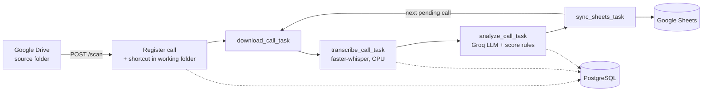

<p align="center">
  
</p>

<p align="center">
  Scans Google Drive for call recordings, transcribes them locally, scores each call with an LLM against a service-desk checklist, and writes the result to Postgres and Google Sheets.
</p>

<p align="center">
  
  
  
  
  
  
</p>

---

## Overview

Call Analyzer automates compliance auditing of manager-client phone conversations for an auto service. It is built around a concrete checklist: did the manager introduce themselves, ask for the VIN, mileage, car body and year, offer diagnostics, book the visit, and stay polite. Every call ends up as a structured record and a row in a Google Sheet, with problem calls highlighted.

Speech-to-text runs on the worker's CPU, so audio never leaves the machine for transcription; only the transcript text is sent to the LLM.

## Highlights

- **Local transcription.** `faster-whisper` on CPU with `int8` quantisation, VAD filtering, temperature 0 and a domain initial prompt (auto-service vocabulary) to reduce mis-hearings.
- **Structured LLM scoring.** Groq chat completions in JSON mode (`llama-3.3-70b-versatile`, falling back to `llama-3.1-8b-instant` and `mixtral-8x7b-32768` on rate limits or errors).
- **Deterministic score.** The model returns checklist flags; the score and the `needs_attention` flag are recomputed in code (`CallAnalyzer._post_process`), so the model does not decide the number.
- **Two Celery queues.** CPU-bound transcription is isolated on its own single-concurrency worker; Drive, LLM and Sheets I/O run on a general worker.
- **Sequential pipeline with retries.** Calls are processed one at a time; each stage retries up to 3 times, and on final failure the next pending call is started so the queue does not stall.
- **Auditable state.** Calls, transcripts (with timestamped segments), analyses, per-stage jobs and logs are persisted in Postgres; requests and tasks carry correlation and trace IDs via `structlog`.

## How it works



Only `.mp3`, `.wav`, `.m4a` and `.ogg` files are picked up. A call moves through `PENDING_DOWNLOAD`, `PENDING_TRANSCRIPTION`, `PROCESSING`, `PENDING_ANALYSIS` and `PENDING_SHEETS`, and ends in `COMPLETED` or `FAILED`.

| Component | Role |
| --- | --- |
| `api` | FastAPI service: scan trigger, call listing, reprocessing, health, metrics |
| `worker-transcription` | Celery worker, queue `transcription`, concurrency 1 |
| `worker-general` | Celery worker, queue `general`: download, analysis, Sheets sync |
| `postgres` / `redis` | State store / Celery broker and result backend |
| `app/ai` | Provider interface, Groq provider, prompts, analyzer with post-processing |
| `app/integrations` | Google Drive and Google Sheets clients (service account) |

## Tech stack

| Layer | Tools |
| --- | --- |
| API | FastAPI, Pydantic v2, pydantic-settings |
| Queue | Celery 5, Redis 7 |
| Storage | PostgreSQL 16, SQLAlchemy 2 (async, asyncpg), repository pattern |
| Speech | faster-whisper 1.0.3 |
| LLM | Groq API over `httpx` |
| Integrations | Google Drive API, Google Sheets API |
| Ops | Docker Compose, structlog |

## Quick start

Prerequisites: Docker with Compose, a Groq API key, and a Google Cloud service account with the Drive and Sheets APIs enabled.

```bash
cp .env.example .env            # then fill in GROQ_API_KEY and the Google IDs
# place the service account key at ./credentials.json (gitignored)
# share the Drive folders and the Sheet with the service account email (Editor)
docker compose up --build
```

The API container creates the tables on start (`python -m scripts.init_db`). Then trigger a scan:

```bash
curl -X POST http://localhost:8000/api/v1/scan
```

Scanning is manual: the repository defines no Celery beat schedule, so call `POST /api/v1/scan` whenever new recordings arrive.

| Endpoint | Purpose |
| --- | --- |
| `GET /docs` | Swagger UI |
| `GET /api/v1/health` | Postgres and Redis connectivity |
| `GET /api/v1/metrics` | Totals, average score, attention and violation counts |
| `POST /api/v1/scan` | Register new Drive files and start the pipeline |
| `GET /api/v1/calls`, `GET /api/v1/calls/{id}` | List calls; detail with transcript, analysis, jobs |
| `POST /api/v1/reprocess/{id}`, `POST /api/v1/reprocess-all` | Re-run one or all calls |
| `GET /api/v1/failed-jobs` | Jobs that ended in `FAILED` |

## Configuration

Defined in `.env.example` and `app/core/config/settings.py`; Compose forwards most of them to every service. Defaults below are the code defaults, while the template uses container hostnames (`postgres`, `redis`).

| Variable | Purpose | Default |
| --- | --- | --- |
| `GROQ_API_KEY` | Groq API key (required for analysis) | empty |
| `GOOGLE_DRIVE_SOURCE_FOLDER_ID` | Folder scanned for recordings | empty |
| `GOOGLE_DRIVE_WORKING_FOLDER_ID` | Folder where shortcuts to registered files are created | empty |
| `GOOGLE_SHEET_ID` | Target spreadsheet | empty |
| `GOOGLE_CREDENTIALS_PATH` | Service account JSON path | `credentials.json` (`/app/credentials.json` in Docker) |
| `LOCAL_STORAGE_DIR` | Downloaded audio directory | `storage` |
| `WHISPER_MODEL_SIZE` | faster-whisper model size | `small` |
| `WHISPER_LANGUAGE` | Transcription language | `ru` |
| `WHISPER_INITIAL_PROMPT` | Domain vocabulary hint | auto-service terms |
| `DATABASE_URL`, `SYNC_DATABASE_URL` | Async and sync Postgres URLs | localhost Postgres |
| `REDIS_URL`, `CELERY_BROKER_URL`, `CELERY_RESULT_BACKEND` | Redis endpoints | `redis://localhost:6379/0` |
| `POSTGRES_USER`, `POSTGRES_PASSWORD`, `POSTGRES_DB`, `POSTGRES_HOST`, `POSTGRES_PORT` | Postgres settings | `postgres`, `postgres`, `call_qc`, `localhost`, `5432` |
| `PROJECT_NAME`, `LOG_LEVEL`, `ENVIRONMENT` | App name, log level, environment | see `settings.py` |
| `RESET_DB` | Compose-only: `true` drops all tables on API start | `false` |

## Project structure

```
app/
  ai/            providers (Groq), prompts, schemas, analyzer with score rules
  api/           routers: calls, health, metrics
  core/          settings, DB session, logging, exceptions
  integrations/  Google Drive and Google Sheets clients
  models/        SQLAlchemy models (call, transcript, ai_analysis, job, log, manager)
  repositories/  data access layer
  services/      call processor, transcription, Drive and Sheets services
  workers/       Celery app and tasks
scripts/         init_db.py, clear_sheets.py
tests/           API and analyzer tests
docker-compose.yml, Dockerfile.api, Dockerfile.worker
```

## Testing

```bash
pytest
```

Two small files exist: `tests/test_services.py` covers the analyzer post-processing (score and attention rules), and `tests/test_api.py` smoke-tests health, metrics and call listing through `TestClient`. The API tests use the configured database, so they expect Postgres to be reachable. The Drive, Sheets and Groq integrations are not covered.

## Status and roadmap

A working prototype tuned to one business domain. No benchmarks or accuracy figures are published, and none are claimed here.

- The checklist, prompts and manager comments are hard-coded for an auto service (Ukrainian and Russian); the checklist should become configurable.
- No scheduler: Drive scanning is triggered manually via the API.
- The API has no authentication and CORS allows all origins; put it behind a gateway before exposing it.
- Alembic is configured but has no migration versions; tables are created by `scripts/init_db.py`.
- The Groq model list is hard-coded; analysis sits behind an `AIProvider` interface but only Groq is implemented.
- `tests/conftest.py` references `aiosqlite`, which is not pinned in `requirements.txt`.
